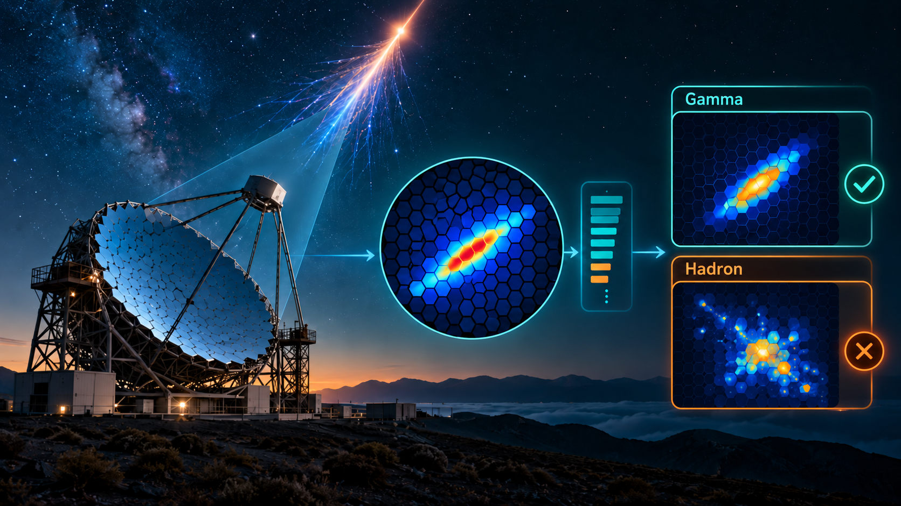
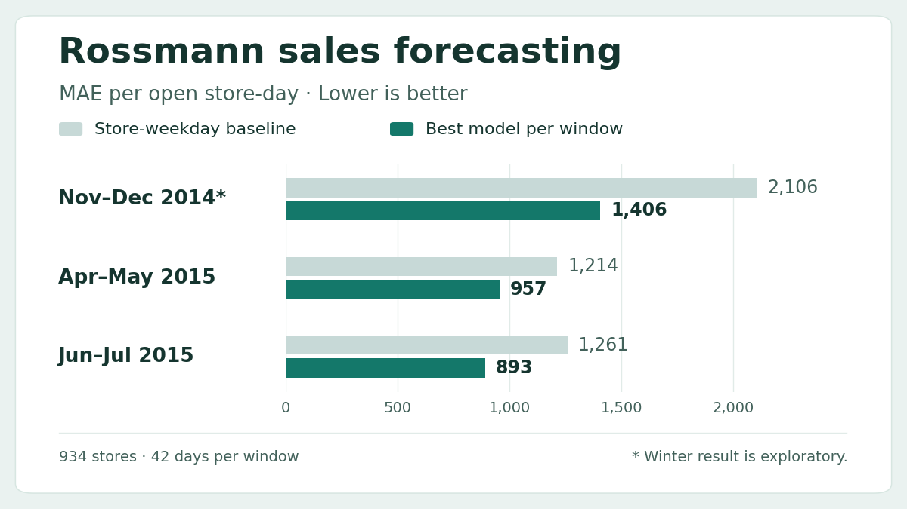

Welcome to my Data Science portfolio.

This portfolio presents selected projects in machine learning,
data analysis, and model evaluation.

## Projects

### MAGIC Gamma Telescope Classification

  

    <h3>MAGIC Gamma Telescope Classification</h3>

    

      Machine-learning classification of gamma-ray induced showers and hadronic
      background events using domain-specific ROC operating points.
    

    

      <a href="projects/magic-gamma/">View project →</a>
    

  

  <figure style="
    margin: 0;
    flex: 0 1 360px;
    text-align: center;
  ">
    

    <figcaption style="
      margin-top: 8px;
      font-size: 0.85em;
      color: #666;
    ">
      AI-generated illustration of the MAGIC gamma/hadron classification workflow.
    </figcaption>
  </figure>

### Rossmann Retail Sales Forecasting

Daily sales forecasts for Rossmann stores using historical sales, planned
promotions, opening schedules, and calendar information. The project covers
data preparation in SQLite, chronological model evaluation, and a batch
forecasting script.

*Validation results based on the [Rossmann Store Sales competition dataset on Kaggle](https://www.kaggle.com/competitions/rossmann-store-sales/data).*

[View project details →](projects/rossmann-retail/)
